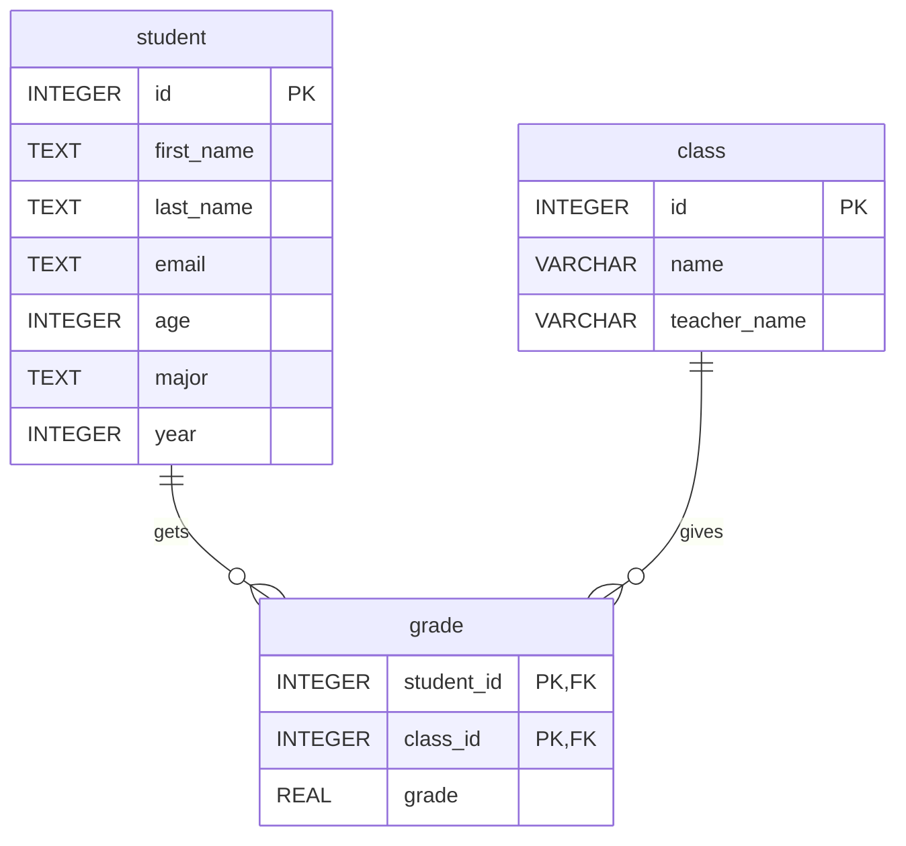

## Schema



## Purpose

This table was created to be able to keep track of the student's classes and the grades they have in each class. This database is used for _averages_ as not to reveal a student's personal information or grade. **Jev** is utilized to enforce this.

## Prompting strategies

The main prompts were mostly zero-shot. In the actual code, the AI uses zero-shot every time, in addition to not being given knowledge of _what_ the info in the database is, just the schema. Since we only pass the schema, the AI does not know the names of all the classes, therefore it needs the name to be exact or it will fail. This can easily be expanded on by passing the entire database.

With proper context given to the AI, and allowing it to use multiple tool calls, modern AI models do not need much more input from the human. I would count that as zero-shot as well, since we only prompt it once, it just does all the work it needs to find the correct answer autonomously. Examples are generally no longer needed unless you need the AI to follow a very specific style of coding to better integrate into the codebase, or if you need it to follow some best practices that are not obvious to the model.

## Sample question

**User:** What's the average grade in CS 452?

```sql
SELECT AVG(grade)
FROM grade
JOIN class ON grade.class_id = class.id
WHERE class.name = 'CS 452';
```

**GPT-6 Luna (low):**  The average grade in CS 452 is approximately **2.81**.

## Denied sample question

**User:** What's the name of the student with the lowest grade in CS 452?

**Harness:** Request denied.

## Additional review

Feel free to look at [examples.md](examples) for further demonstration of the program.

